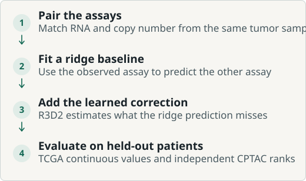
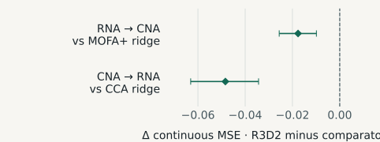
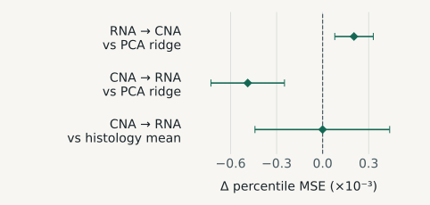

---
{
  "title": "GeNeDis Multi-Omics Hackathon",
  "summary": "I built a workflow to predict RNA expression from DNA copy number, and vice versa, in lung tumors. I tested how well it recovered measured values and whether it could recover gene rankings in a separate cohort.",
  "shortSummary": "Predicting lung-cancer RNA expression from copy number and vice versa, with an independent test of gene-rank transfer.",
  "category": "research",
  "context": "independent",
  "status": "ongoing",
  "statusDetail": "Updated submission sent · Outcome pending",
  "role": "Cohort design, data pipeline & model evaluation",
  "featured": false,
  "draft": false,
  "topics": ["Multi-omics", "Lung cancer", "Cross-modal reconstruction"],
  "links": [{"label": "Hackathon brief", "url": "https://2026.genedis.org/hackathon/", "kind": "write-up"}],
  "publicationIds": [],
  "updated": "2026-11-09",
  "dateLabel": "October 2026–present",
  "sortDate": "2026-10-07"
}
---

## The challenge

Can one tumor assay recover information usually measured by another? RNA expression measures how much RNA a gene produces. DNA copy number measures how many copies of a gene’s region are present. The plots use CNA for copy-number alterations. I tested prediction in both directions using samples from lung adenocarcinoma and lung squamous cell carcinoma. [GeNeDis hackathon brief](https://2026.genedis.org/hackathon/)

## How the submitted workflow worked

I paired the two assays from the same tumor sample and kept one sample per patient. The workflow learned from those pairs, then predicted the missing assay using only the assay available for a new tumor.

<figure id="genedis-workflow" class="project-figure">

<figcaption>Ridge regression estimates the target profile. The R3D2 neural network learns a correction to that estimate from the same observed assay.</figcaption>

</figure>

### Pair the assays and split by patient

My Snakemake pipeline checked sample identifiers and excluded ambiguous gene matches. I split the 991 TCGA patients into 594 for training, 198 for validation and 199 for testing. Gene selection and scaling used the training patients. [TCGA cohorts via cBioPortal DataHub](https://github.com/cBioPortal/datahub)

### Learn what ridge regression misses

For each prediction direction, I trained a ridge model and asked a small neural network to predict its remaining errors. The network learned those corrections in a compressed representation of the target assay. I compared the resulting R3D2 model with simpler models based on principal components (PCA), canonical correlation analysis (CCA) and [MOFA+ factors](https://doi.org/10.1186/s13059-020-02015-1).

## What the comparisons showed

### TCGA · How close were the predicted values?

I compared each prediction with the measured, standardized assay values for the 199 TCGA test patients. I had already examined this split during development. Each row compares R3D2 with the strongest listed baseline for that direction.

**How to read the plot.** The dot is R3D2’s mean squared error (MSE) minus the baseline’s. Zero is a tie. Dots to the left mean R3D2 had lower error. The bars show the uncertainty estimated by resampling the same patients for both models.

<figure id="genedis-tcga" class="project-figure">

<figcaption>R3D2 reduced MSE by 0.0176 versus MOFA+ ridge for RNA to copy number, and by 0.0484 versus CCA ridge for copy number to RNA. Bars show 95% paired patient bootstrap intervals for the fitted models.</figcaption>

</figure>

R3D2 had lower reconstruction error in both directions on this split. I used a separate cohort to ask whether it could still recover relative differences across genes when assay scales changed.

### CPTAC · Did gene rankings transfer?

I refit the models using TCGA patients only and tested on 217 independent CPTAC tumors. To make the two cohorts comparable, I ranked genes within each tumor on a shared panel. The benchmark tests transfer of relative gene ranks. Its error scale is based on percentiles. [CPTAC adenocarcinoma](https://www.linkedomics.org/data_download/CPTAC-pancan-LUAD/) · [CPTAC squamous carcinoma](https://www.linkedomics.org/data_download/CPTAC-pancan-LSCC/)

**How to read the plot.** Left of zero again favors R3D2. The tumor-type mean, labeled “histology mean” in the plot, predicts the same average profile for every tumor of a given type. It shows how much the observed assay adds beyond knowing the tumor type.

<figure id="genedis-cptac" class="project-figure">

<figcaption>Against PCA ridge, R3D2’s percentile MSE changed by +0.000204 for RNA to copy number and −0.000488 for copy number to RNA. Bars show 95% paired patient bootstrap intervals for the fitted models.</figcaption>

</figure>

PCA ridge did better at ranking copy number from RNA. In the reverse direction, R3D2 improved on PCA ridge and performed about as well as the tumor-type average. Recovery of absolute values across platforms and clinical performance remain open.

## Submission status

The organizers acknowledged the initial package on November 3, 2026. I sent the updated package with R3D2 and the CPTAC benchmark on November 4. The outcome is pending.
