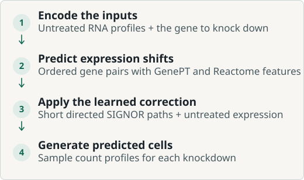
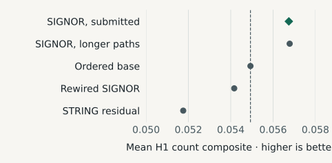

---
{
  "title": "Virtual Cell Challenge 2026",
  "summary": "I built and submitted a model to predict how unfamiliar cell lines respond when a gene is turned down. I tested whether known signaling relationships could improve a predictor trained on measured responses.",
  "shortSummary": "Predicting CRISPRi responses in unseen cell contexts with a learned response model and directed signaling paths.",
  "category": "research",
  "context": "independent",
  "status": "ongoing",
  "statusDetail": "Final entry submitted · Results pending",
  "role": "Research design, model development & evaluation",
  "featured": true,
  "draft": false,
  "topics": ["Perturbation response", "Transfer evaluation", "Network features"],
  "links": [
    {"label": "Challenge brief", "url": "https://arcinstitute.org/news/virtual-cell-challenge-2026", "kind": "write-up"},
    {"label": "Official rules", "url": "https://virtualcellchallenge.org/rules", "kind": "write-up"}
  ],
  "publicationIds": [],
  "updated": "2026-11-09",
  "dateLabel": "September 2026–present",
  "sortDate": "2026-09",
  "featuredOrder": 2
}
---

## The challenge

When a gene is turned down, which other genes change their expression? CRISPR interference (CRISPRi) reduces transcription of the target gene and lets researchers measure how cells respond. In this challenge, the model received untreated single-cell RNA profiles and a target gene. It had to predict a whole population of treated cells in a cell line whose responses were unavailable to the model. I designed the comparisons and built the workflow from training through submission. [Arc Institute’s challenge brief](https://arcinstitute.org/news/virtual-cell-challenge-2026)

## How the submitted model worked

The workflow first predicts how much each gene’s expression will shift. It then uses those shifts to simulate RNA counts for individual cells, so the submission represents a population with cell-to-cell variation.

<figure id="vcc-workflow" class="project-figure">

<figcaption>From untreated RNA to simulated treated cells. SIGNOR adjusts the base estimate where usable signaling paths are available.</figcaption>

</figure>

### Learn the base response

I trained on public CRISPRi Perturb-seq data from K562, RPE1, HepG2 and Jurkat cells. The base model, which I call Ordered, combined three training runs with [GenePT embeddings](https://pubmed.ncbi.nlm.nih.gov/37905130/) and [Reactome pathway membership](https://reactome.org/). It keeps the intervention and measurement roles distinct. Turning down gene A to predict gene B can produce a different result from turning down gene B to predict gene A. [Training datasets](https://github.com/Virtual-Cell-Research-Community/scPertEval/blob/main/docs/user-guide/datasets.md)

### Use signaling paths where available

A second model learned which corrections to make from the untreated RNA profile and directed [SIGNOR](https://doi.org/10.1093/nar/gkac883) paths of up to four steps. It treated activating, inhibitory and unknown-sign links separately and fell back to the base estimate for gene pairs without usable paths. I sampled from negative binomial or Poisson distributions to turn the resulting shifts into single-cell RNA counts.

## What the comparisons showed

I held Ordered fixed and tested what each graph added on 65 knockdown targets in public H1 cells. The graph variants included a longer-path version of SIGNOR, a version with SIGNOR’s connections shuffled while preserving each gene’s degree, and a version using the STRING association network. The shuffled graph checks whether the specific connections helped. The local score combines six measures of how closely simulated cells match measured responses.

**How to read the plot.** Each dot is a mean composite score across three fixed sets of sampled cells. The dashed line is the Ordered base model. Farther right is better.

<figure id="vcc-h1-counts" class="project-figure">

<figcaption>On the local H1 benchmark, submitted SIGNOR scored 0.05675, compared with 0.05493 for Ordered and 0.05416 for the rewired control.</figcaption>

</figure>

The four-step model beat Ordered in all three sampling sets. The longer-path model had a slightly higher mean, but beat Ordered in two of the three, so I submitted the shorter version. All three sets came from the same cell line, and I examined H1 repeatedly during development. Performance on unseen cell lines remains open.

## Submission status

I submitted the final SIGNOR model on November 6, 2026, Korea time. The organizers processed the entry. The final competition score and ranking are pending.
